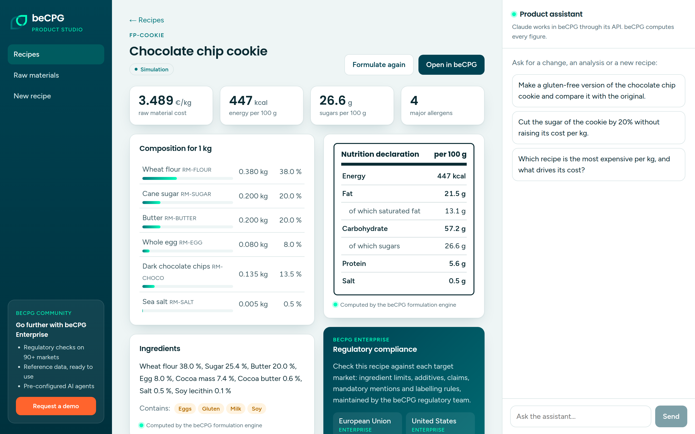
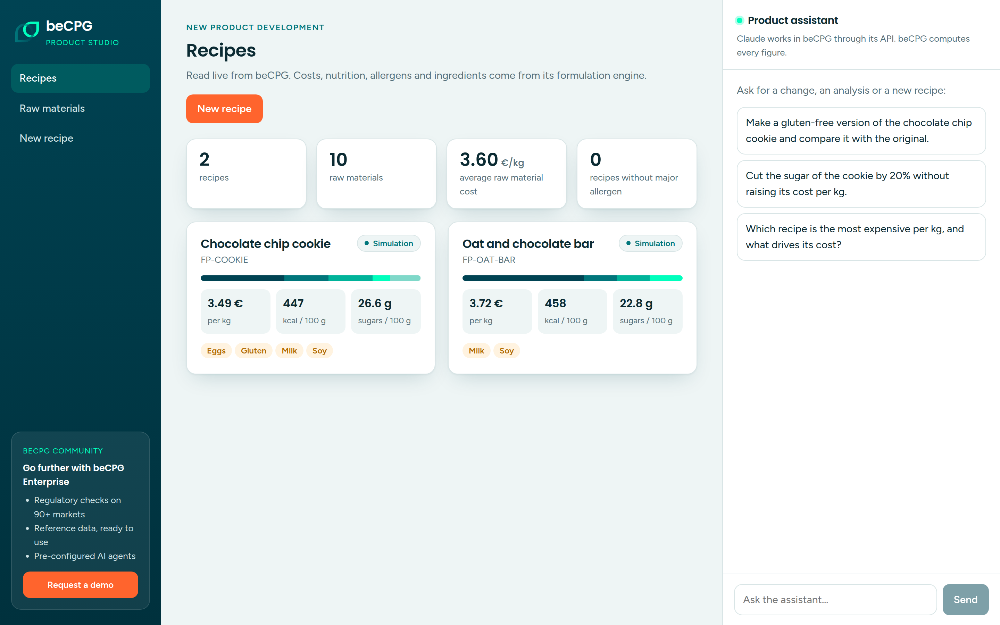
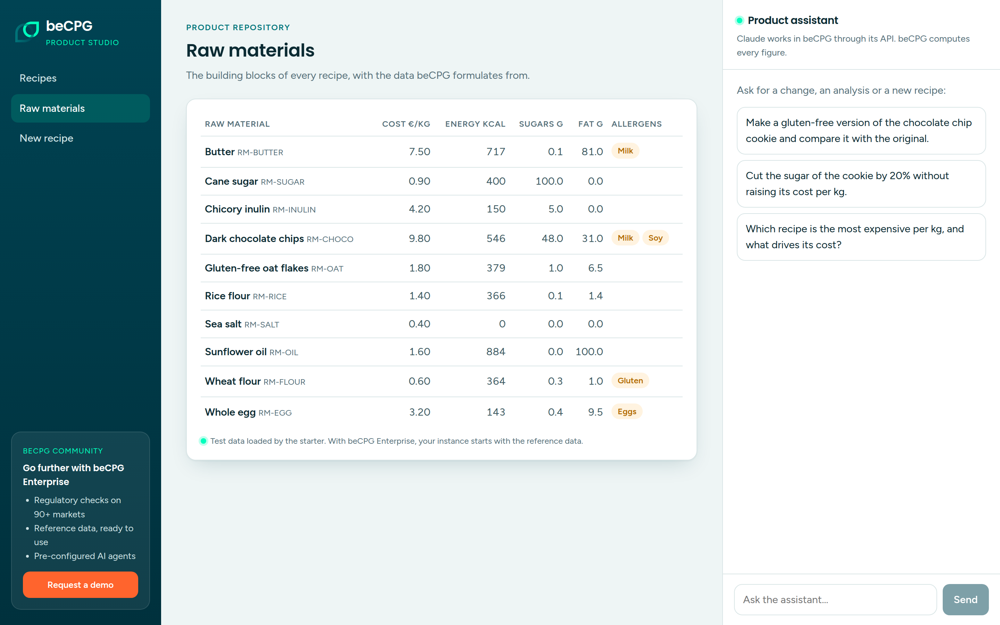
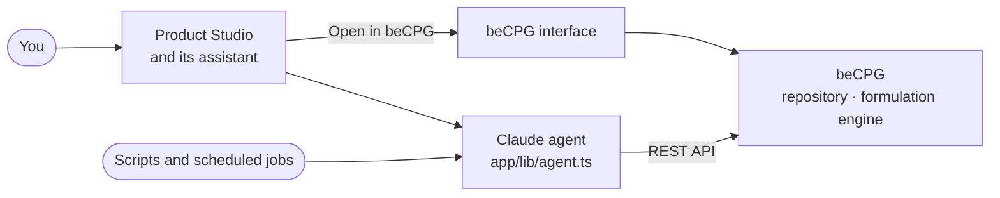

<div align="center">


# beCPG starter

**Let Claude run your PLM.**

An open source starter where an AI agent works directly in beCPG, the PLM for food, beverage and
cosmetics: it reads your products, builds recipes, and lets the beCPG formulation engine compute
costs, nutrition, allergens and ingredients.

[](LICENSE) [](https://github.com/becpg/becpg-community) [](#talk-to-your-plm)

[Quick start](#quick-start) · [Talk to your PLM](#talk-to-your-plm) · [Build your own agents](#build-your-own-agents) · [Community and Enterprise](#start-with-community-go-further-with-enterprise)



</div>

## What you get

- **beCPG Community running on your machine**, in one command: product repository, formulation
  engine, versions, workflows, a full user interface and a REST API.
- **Product Studio**, a web app in the beCPG colours with a **product assistant** built on Claude.
  Ask it for a variant, a cost analysis or a new recipe: it works in beCPG through the API, and every
  figure it shows comes from the formulation engine.
- **The same agent on the command line**, and its tools in one TypeScript file: the starting point
  for your own agents.

The agent does not guess numbers. It changes the recipe in beCPG, beCPG formulates it, and the agent
reads back the result. Detailed editing stays in the beCPG interface, one click away.

## Quick start

You need Docker (8 GB of RAM free), Node.js 20+, git and a [Claude API key](https://platform.claude.com).

```bash
git clone https://github.com/becpg/becpg-starter.git
cd becpg-starter
./scripts/start.sh
```

The first run builds beCPG Community from its [open source repository](https://github.com/becpg/becpg-community)
(10 to 20 minutes, then a few seconds), starts it and loads test data: 10 raw materials with their
nutrients, allergens, ingredients and costs, and 2 recipes.

Add your Claude API key to `.env` (`ANTHROPIC_API_KEY=...`), then start the app:

```bash
cd app
npm install
npm run dev
```

| What | Where |
|------|-------|
| Product Studio and its assistant | http://localhost:3000 |
| beCPG user interface | http://localhost:8180/share |
| beCPG REST API | http://localhost:8080/alfresco/service/becpg/remote/ |

## Talk to your PLM

Type a request in the assistant panel. A few to start with:

> Make a gluten-free version of the chocolate chip cookie and compare it with the original.

> Cut the sugar of the cookie by 20% without raising its cost per kg.

> Which recipe is the most expensive per kg, and what drives its cost?

The agent chains the tools it needs, and you see each step as it happens:

| Tool | What it does in beCPG |
|------|------------------------|
| `list_recipes`, `get_recipe` | Reads recipes with their composition, nutrition, allergens, ingredients and cost |
| `list_raw_materials` | Reads the raw materials available, with their data |
| `save_recipe` | Creates a recipe or a variant, or changes a composition, then formulates it |
| `formulate_recipe` | Runs the formulation engine again |

When the agent saves a recipe, the app opens it: what you see on screen is what beCPG computed.

<table>
<tr>
<td width="50%"></td>
<td width="50%"></td>
</tr>
<tr>
<td align="center">Recipes, read live from beCPG</td>
<td align="center">Raw materials, the data beCPG formulates from</td>
</tr>
</table>

## Build your own agents

The agent is one file, [`app/lib/agent.ts`](app/lib/agent.ts): a system prompt and a few tools, each a
call to the beCPG API. Add a tool and the agent can use it, in the app and on the command line:

```bash
cd app
npm run agent -- "Create a vegan variant of the oat bar and give me its cost per kg"
```

Run it from a scheduled job, plug it into your ERP flows or your own interface. To extend the
starter itself, open the folder in [Claude Code](https://claude.com/claude-code): `AGENTS.md` and the
`becpg-api` skill tell it how the beCPG API works and what it must not rebuild.

## Start with Community, go further with Enterprise

beCPG Community is free and open source: enough to try the idea, show a demo on your own recipes and
start building. beCPG Enterprise takes you much further.

| | Community, in this starter | Enterprise |
|---|---|---|
| Product repository, formulation engine, REST API, beCPG interface | ✓ | ✓ |
| Product assistant and agents you build on the API | ✓ | ✓ |
| **Pre-configured agents**: Chef AI assistant, supplier document extraction, recipe optimisation, MCP server for your own agents | | ✓ |
| **Reference data**: nutrient databases, allergens, ingredients, list values and product templates, ready to use | Test data | ✓ |
| **Regulatory compliance** on 90+ markets: ingredient limits, additives, claims, mandatory mentions, maintained by our regulatory team | | ✓ |
| **Labelling**: ingredient declaration, nutrition and front-of-pack rendering, configured for your markets | Engine only | ✓ |
| Supplier portal, BI cubes, hosting, upgrades and support | | ✓ |

<div align="center">

**[See it on your own products: request a demo →](https://www.becpg.net/contact-us/)**

</div>

## How it fits together



## FAQ

**Is it free?**
The starter is under the MIT license and beCPG Community under the LGPL v3. The Claude API is billed by
Anthropic on your own key. The Enterprise modules and the support are paid.

**Can the agent break my data?**
It only works through the beCPG API, with the rights of the beCPG user you configure, and it saves
variants under new codes when you ask it to explore. Point it at a test instance before your own data.

**Can I use another model or my own agent framework?**
Yes. The tools are plain calls to the beCPG REST API: wrap them in the framework you use.

**Can I run this in production?**
The starter is a development setup: default passwords, no TLS, no backup. For production, use your own
configuration or the beCPG hosting.

## What is in this repository

| Path | Content |
|------|---------|
| `docker-compose.yml` | beCPG Community, MySQL, Solr and the document transformer |
| `scripts/start.sh` | Starts the stack, initialises beCPG and loads the test data |
| `scripts/build-images.sh` | Builds the beCPG Community images from the open source repository |
| `scripts/seed.mjs` | Test data created through the API, safe to run again |
| `scripts/becpg.mjs` | Command line client for the beCPG API |
| `app/` | Product Studio (Next.js); `lib/agent.ts` is the agent, `lib/becpg.ts` the API client |
| `AGENTS.md`, `.claude/skills/becpg-api` | Instructions for Claude Code and other coding agents |

## About beCPG

beCPG is an open source PLM for the food, beverage and cosmetics industries, developed in France since
2010 and used by 130+ manufacturers.
[Website](https://www.becpg.net) · [Documentation](https://www.becpg.net/docs/en/) ·
[API reference](https://www.becpg.net/docs/en/development/API.html) ·
[beCPG Community](https://github.com/becpg/becpg-community)

## License

The starter is under the [MIT license](LICENSE). beCPG Community is under the LGPL v3.
